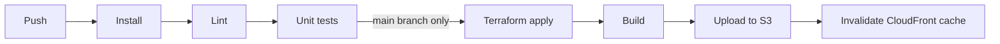
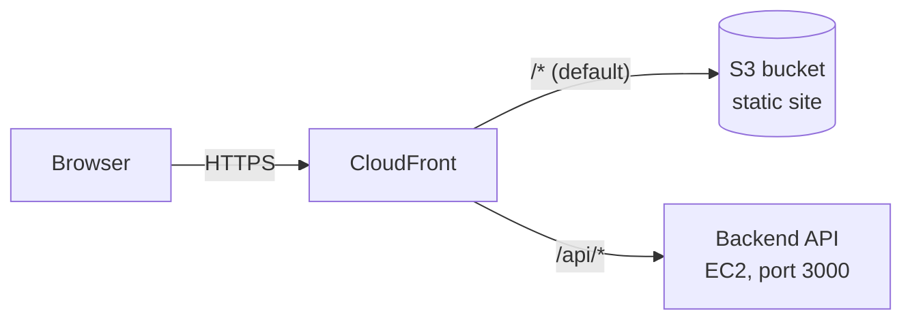

# Jira Clone Frontend

A Jira-style project management app built with React. Users can sign up, create projects, invite members and manage tasks on a drag-and-drop Kanban board.

This repository contains the frontend only. The backend is a separate Node.js API.

## Features

- Sign up, log in and log out, with cookie-based authentication and automatic token refresh
- Avatar selection or image upload after signing up
- A dashboard with an overview, recent activity, a project list and an "assigned to me" task list
- Project creation, with a member search to add teammates
- A Kanban board with **To Do**, **In Progress** and **Done** columns:
  - drag tasks between columns to change their status
  - tasks are sorted by priority, then by due date
  - create, edit and delete tasks
  - comment on tasks
- Global search
- Account settings: update your details and change your password

## Tech stack

| Area | Tools |
|---|---|
| UI | React 19, React Router 7 |
| Drag and drop | dnd-kit |
| HTTP | Axios |
| Build | Vite |
| Testing | Vitest, React Testing Library, jsdom |
| Linting | ESLint |
| CI/CD | GitHub Actions |
| Infrastructure | Terraform, AWS S3, AWS CloudFront |

## Project structure

```
.
├── .github/workflows/
│   └── continuous-integration.yml   # CI/CD pipeline
├── infra/
│   └── main.tf                      # Terraform: S3 + CloudFront
└── jira_clone/                      # React app
    ├── src/
    │   ├── api/axiosInstance.js     # Axios client with 401 refresh handling
    │   ├── context/AuthContext.jsx  # Current user state
    │   ├── pages/                   # Login, signup, avatar, dashboard, project
    │   ├── components/              # Dashboard tabs, settings, search
    │   │   └── board/               # Kanban board, task card, task modal and panel
    │   └── App.jsx                  # Routes
    └── vite.config.js               # Dev proxy and test config
```

## Running locally

Requirements: Node.js 22 or later, and the backend API running locally.

```bash
cd jira_clone
npm install
npm run dev
```

In development, Vite proxies every request that starts with `/api` to the backend at `http://localhost:3002` and strips the `/api` prefix. Change the target in `vite.config.js` if your backend runs on a different port.

| Command | What it does |
|---|---|
| `npm run dev` | Starts the development server |
| `npm run build` | Builds the production site into `dist/` |
| `npm run preview` | Serves the production build locally |
| `npm run lint` | Runs ESLint |
| `npx vitest run` | Runs the test suite once |

## API endpoints

These are the backend endpoints the frontend calls. All requests go through `/api`, which is proxied to the backend in development and routed by CloudFront in production. Authentication uses cookies, sent with `withCredentials`.

### Authentication and account

| Method | Endpoint | Purpose |
|---|---|---|
| `POST` | `/users` | Create an account |
| `POST` | `/login` | Log in and set the auth cookies |
| `POST` | `/logout` | Log out |
| `POST` | `/refresh` | Get a new access token. Called automatically when a request returns `401` |
| `POST` | `/displayimage` | Save the user's avatar, either a preset option or an uploaded image |
| `PUT` | `/updatedetails` | Update the user's profile details |
| `PUT` | `/changepassword` | Change the user's password |

### Dashboard and search

| Method | Endpoint | Purpose |
|---|---|---|
| `GET` | `/dashboard` | Get the current user and dashboard summary. Also used to check whether the user is logged in |
| `GET` | `/recentactivity` | Get the user's recent activity |
| `GET` | `/dashboard/tasks` | Get the tasks assigned to the user |
| `GET` | `/search?q=` | Search across the app |

### Projects and members

| Method | Endpoint | Purpose |
|---|---|---|
| `GET` | `/projects` | List the user's projects |
| `POST` | `/create-project` | Create a project |
| `GET` | `/project/:projectId` | Get a project with its tasks and members |
| `GET` | `/member-search?q=` | Search users to add when creating a project |
| `GET` | `/projects/:projectId/member-search?q=` | Search users to add to an existing project |
| `POST` | `/projects/:projectId/members` | Add a member to a project |

### Tasks and comments

| Method | Endpoint | Purpose |
|---|---|---|
| `POST` | `/createtask/:projectId` | Create a task in a project |
| `PUT` | `/updatetask/:taskId` | Edit a task |
| `PATCH` | `/updatestatus/:taskId` | Change a task's status, after a drag on the board |
| `DELETE` | `/deletetask/:taskId` | Delete a task |
| `GET` | `/getcomments/:taskId` | Get a task's comments |
| `POST` | `/comment/:taskId` | Add a comment to a task |
| `DELETE` | `/deletecomment/:commentId` | Delete a comment |

### Token refresh

`src/api/axiosInstance.js` handles expired sessions. When a request fails with `401`, the client calls `/refresh` once and retries the original request. If the refresh also fails, the user is sent to `/login`. Requests to `/login` and `/refresh`, and requests marked `skipAuthRefresh`, are never retried.

## Tests

Tests use Vitest and React Testing Library and run in a simulated browser (jsdom). The API and auth context are mocked, so no backend is needed.

| File | What it covers |
|---|---|
| `src/App.test.jsx` | Smoke tests for the whole app: the login and signup pages load, navigation between them works, and the login form sends credentials and shows server errors |
| `src/components/board/TaskCard.test.jsx` | Task card rendering: title, description, priority, due date and assignee |

## CI/CD pipeline

The pipeline is defined in `.github/workflows/continuous-integration.yml` and runs on every push.



### Job 1: `test` (every branch)

1. Check out the code and set up Node.js 22, with npm caching
2. Install dependencies with `npm ci`
3. Lint with `npm run lint`
4. Run the unit tests with `npx vitest run`

### Job 2: `deploy` (only on `main`, and only if `test` passes)

1. **Authenticate to AWS with OIDC.** GitHub Actions assumes an IAM role directly, so no AWS access keys are stored in the repository.
2. **Create or update the infrastructure** with `terraform init` and `terraform apply`.
3. **Read the Terraform outputs:** the bucket name, the CloudFront distribution ID and the site URL.
4. **Build the site** with `npm run build`.
5. **Upload it** with `aws s3 sync dist/ s3://<bucket> --delete`.
6. **Invalidate the CloudFront cache** so visitors get the new version immediately.

## Infrastructure (Terraform)

`infra/main.tf` defines everything the site runs on, in `ap-southeast-2`.



| Resource | Purpose |
|---|---|
| S3 bucket | Stores the built site. Public access is fully blocked |
| Origin Access Control and bucket policy | Let only this CloudFront distribution read the bucket |
| CloudFront distribution | Serves the site over HTTPS, with two origins: the S3 bucket and the backend |
| `/api/*` cache behavior | Forwards API requests to the backend with caching disabled, passing cookies, headers and request bodies through |
| `spa-rewrite` function | Rewrites page routes such as `/dashboard` to `/index.html`, so React Router can handle them and refreshing works |
| `strip-api` function | Removes the `/api` prefix before a request reaches the backend, matching the local Vite proxy |

Because the site and the API are served from the same CloudFront domain, the browser sees a single origin. No CORS configuration is needed, and the auth cookies work without cross-site settings.

Terraform state is stored remotely in the S3 bucket `cd-terraform-state-bucket`, under the key `jira-clone-frontend/terraform.tfstate`.

### Setup required in AWS and GitHub

These are created once by hand and aren't managed by Terraform:

- **An IAM role for GitHub Actions** with a trust policy for this repository (`repo:1322harshd/Jira-Clone-Frontend:*`) and permissions for the site bucket, the state bucket and CloudFront
- **The Terraform state bucket**
- **A repository secret `BACKEND_DOMAIN`** containing the backend's EC2 public DNS name, for example `ec2-12-34-56-78.ap-southeast-2.compute.amazonaws.com`. CloudFront does not accept a raw IP address as an origin

### Running Terraform manually

```bash
cd infra
terraform init
terraform plan -var="backend_domain=<backend-dns-name>"
terraform apply -var="backend_domain=<backend-dns-name>"
```

### Tearing down

```bash
aws s3 rm s3://jira-clone-frontend-harsh --recursive   # the bucket must be empty
cd infra
terraform destroy -var="backend_domain=unused"
```

Disable the `deploy` job first, otherwise the next push to `main` recreates everything.

## License

See [LICENSE](LICENSE).
